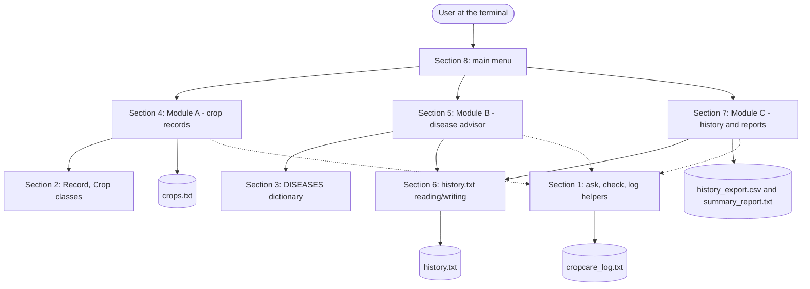
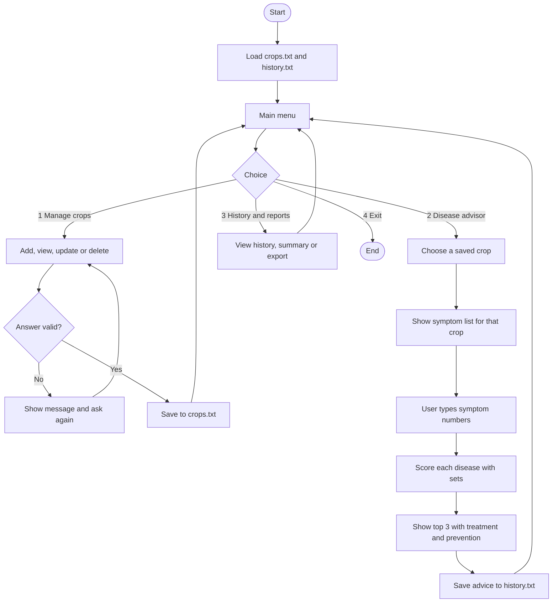
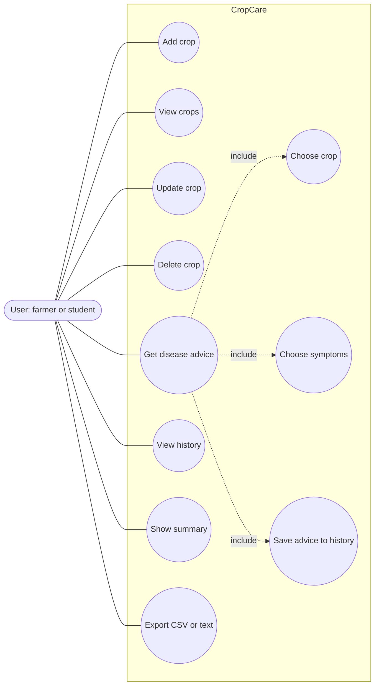
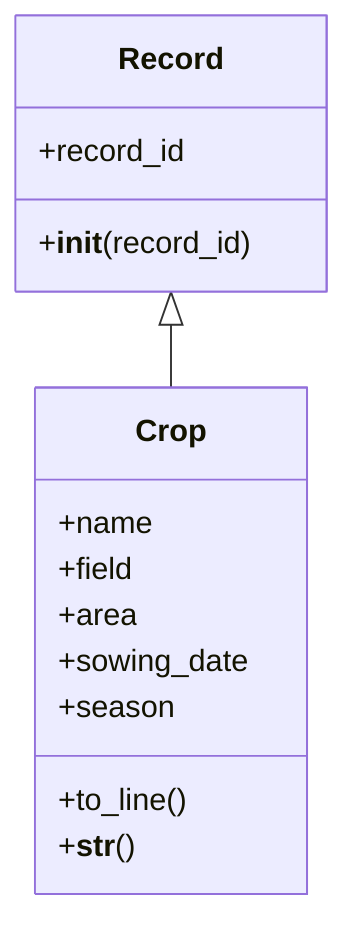
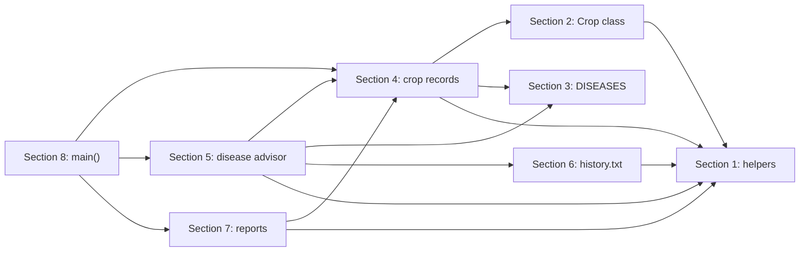
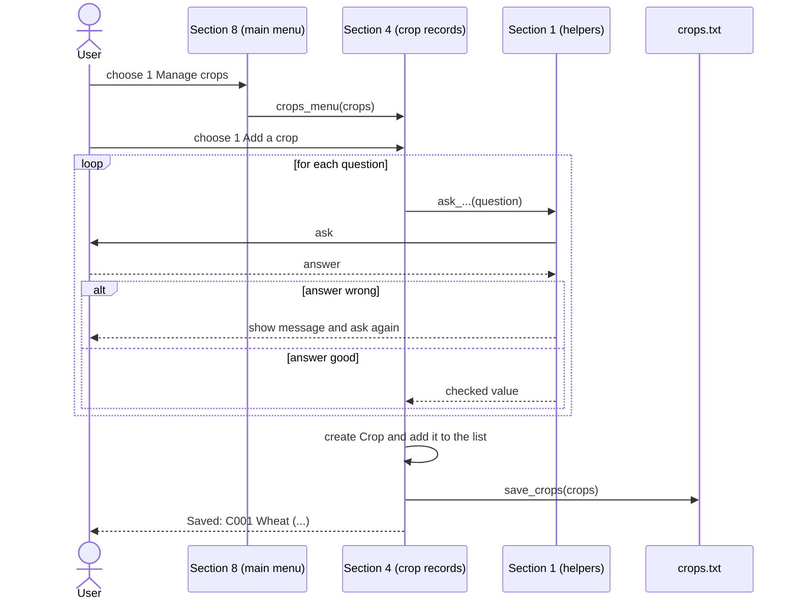
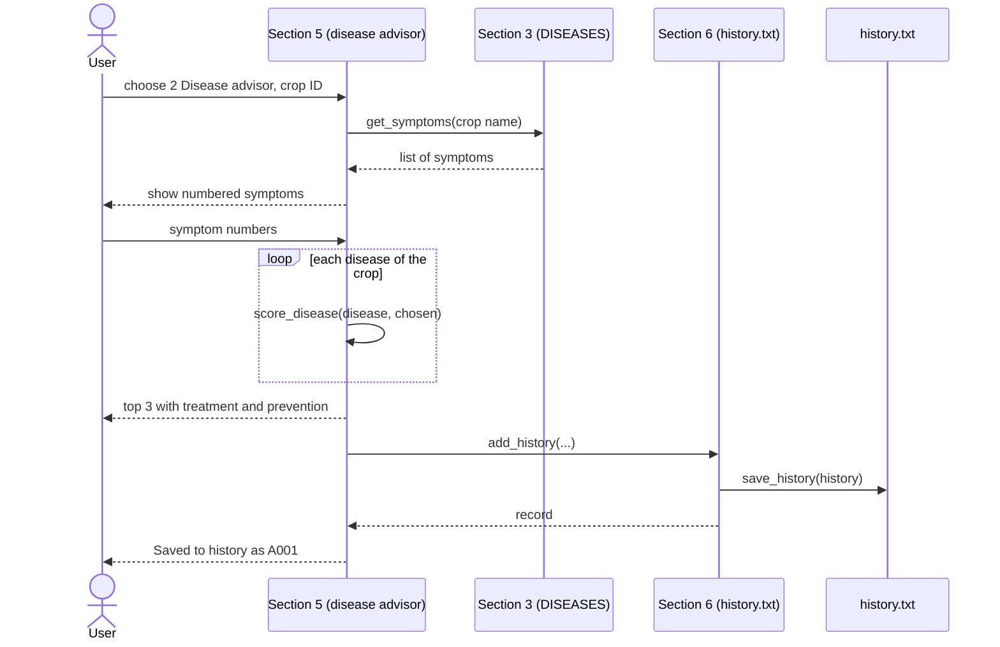
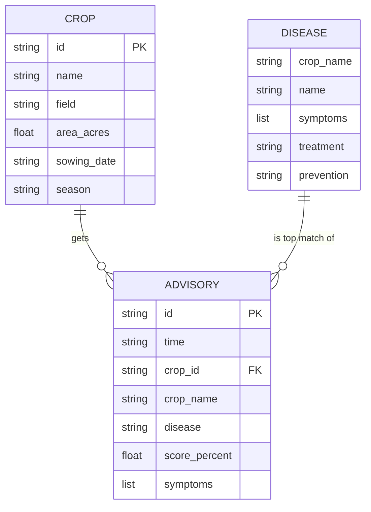

# Design: CropCare

Author: Aayan Bhaisal | Reg. No. 26BAI10444 | VIT Bhopal University | B.Tech AI & ML, 1st Year

The diagrams are written in Mermaid, which GitHub shows automatically. For the PDF report, paste each block into https://mermaid.live and export it as a PNG (or redraw it in draw.io).

## 1. System architecture

All the code lives in one file, `cropcare.py`, split into 8 sections. The
diagram below shows the sections as if they were separate boxes, to make the
responsibilities clear, even though there is only one file on disk.



## 2. Workflow diagram



## 3. Use case diagram

Mermaid has no real UML use case shape, so this uses an actor and ovals. Redraw it in draw.io with the standard stick figure if you prefer.



## 4. Class diagram and component diagram

The program has only two classes. Most of the logic is in functions inside the modules.



Component diagram (which section calls which, inside the one file):



## 5. Sequence diagrams

### 5.1 Add a crop



### 5.2 Get disease advice



## 6. Storage design

Data is saved in text files, so the ER diagram is the logical model. The disease list lives inside the program as a Python dictionary.

### 6.1 ER diagram



`DISEASE` is not a file. It is the dictionary `DISEASES` in Section 3 of `cropcare.py`. A crop is linked to its diseases by the crop name. The advisory line stores the crop name and disease name as text so the history is still readable after a crop is deleted.

### 6.2 Schema design

**crops.txt**: one crop per line, parts separated by `|`

```
C001|Wheat|North Field|2.5|2025-11-15|Rabi
id | crop | field | acres | sowing date | season
```

**history.txt**: one advice per line, symptoms separated by `;`

```
A001|2026-09-19 10:28:25|C001|Wheat|Loose Smut|66.7|symptom one;symptom two
id | time | crop id | crop | top disease | score | symptoms
```

**DISEASES dictionary**

```
DISEASES = { "Wheat": [ {"name": ..., "symptoms": [...], "treatment": ..., "prevention": ...}, ... ], "Rice": [...], ... }
```

| Field | Rule |
|---|---|
| id | `C` or `A` followed by digits, made by the program |
| field name | 1 to 30 characters, no `\|` or `;` |
| area | more than 0 and at most 10000 acres |
| sowing date | `YYYY-MM-DD`, real date, not in the future, year 2000 or later |
| season | Kharif, Rabi or Zaid |

## 7. Design decisions and reasons

| Decision | Instead of | Reason |
|---|---|---|
| Command-line menus | a window (Tkinter) or a website | the course teaches core Python, so the focus stays on the logic |
| Rule-based advisor using sets | machine learning | the course does not cover ML libraries and there is no labelled data. Every score can be explained by hand. |
| Score = matched / all symptoms in both sets | only counting matches | counting alone favours diseases with long symptom lists. This also lowers the score when the user chooses symptoms the disease does not have. |
| Symptoms chosen from a numbered list | typing free text | no spelling problems, so matching is exact |
| Only crops that are in the disease list can be saved | any crop name | a crop without disease data would be useless in the advisor |
| Plain text files with `\|` between parts | JSON or a database | easy to open and read in Notepad, and uses only what the course teaches |
| History stores names as text | storing only ids | the history stays readable after deletions |
| Separate files for each job | one long file | easier to read, test and explain |
| Plain `assert` tests | a test framework | nothing to install, easy to read |

## 8. Disease list, scoring method and evaluation

The assignment asks for these three items for computation-heavy courses. They are included in case the evaluator looks for them.

**Dataset description.** `DISEASES` in Section 3 of `cropcare.py` has 10 diseases for 5 crops (2 each for Wheat, Rice, Tomato, Potato and Maize). Each disease has 3 or 4 symptom phrases, a treatment note and a prevention note. It was written from general agricultural knowledge. Before submitting, check each entry against sources such as ICAR, a state agricultural university or KVK material and list them in the references.

**Scoring method.** For a disease with symptom set D and chosen symptom set S the score is `|D ∩ S| / |D ∪ S| * 100`. It is 100 when S equals D and 0 when they share nothing. A score of 60 or more is High, 30 or more is Medium, below that is Low.

**Evaluation.** There is no labelled field data, so an accuracy percentage would mean nothing and none is claimed. The logic is checked with tests: exact scores, sorted results, the limit of 3, and checks that every disease entry is complete. Manual tests are in `docs/TESTING.md`.

## 9. Future enhancements

- More crops and diseases, and pests.
- Give distinctive symptoms more weight than common ones.
- A window (Tkinter) or a web page, and Hindi language support.
- A machine learning version trained on a labelled dataset (for example from Kaggle) to compare with this rule-based one.
